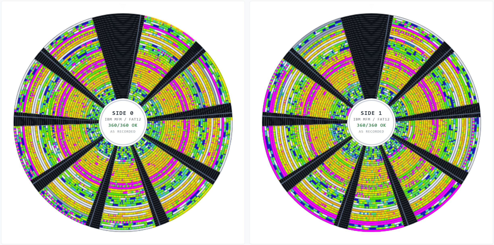
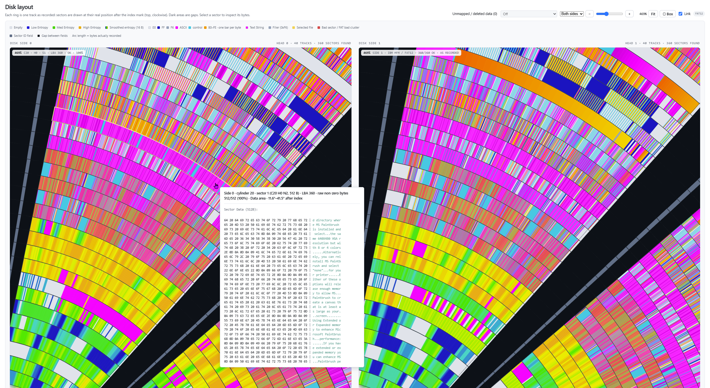
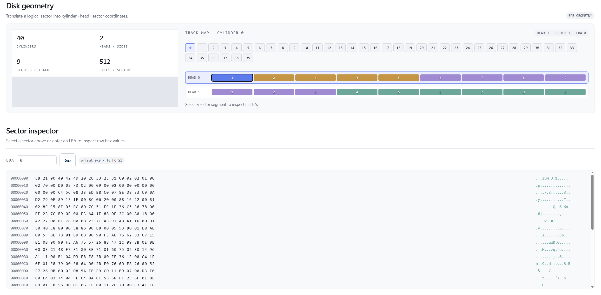
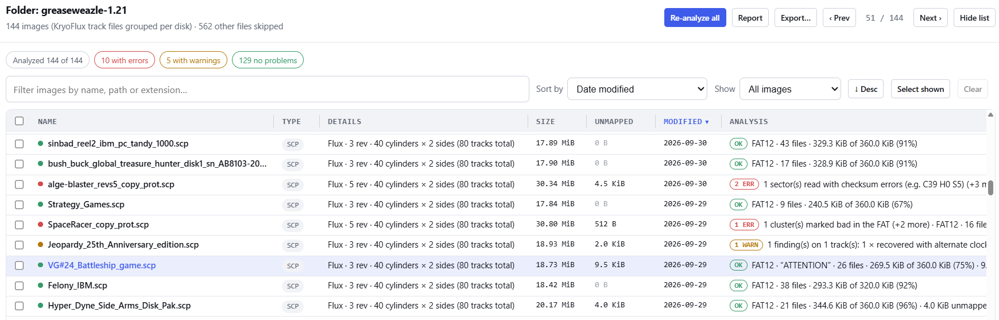
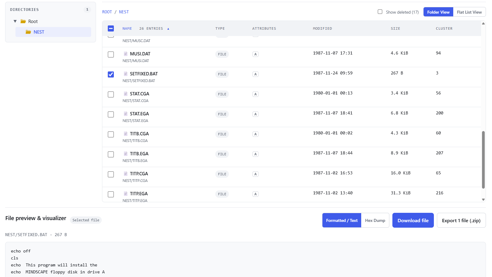
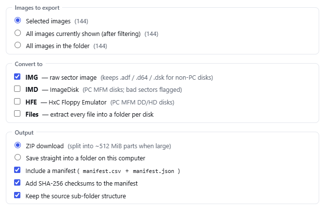
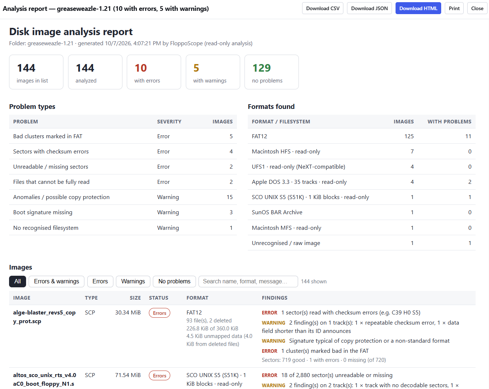
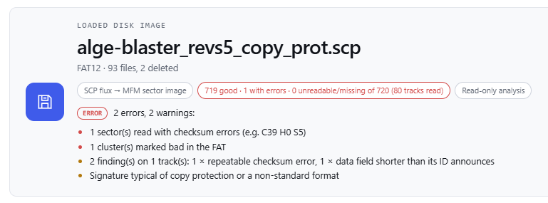

# FloppoScope

**See what's on the disk.** FloppoScope is a single-file, browser-based analyzer for floppy disk images. Open an image (or a whole folder of them) to inspect the boot record, allocation tables, directory tree and raw sectors, without mounting anything.

Everything runs locally in your browser. Nothing is uploaded, and your images are never modified.

**Try it:** https://0ldstaph.github.io/FloppoScope/

Or download `index.html` and open it in any modern browser. No server, install or build step is needed.

## Features

* **Disk layout map.** Every sector is drawn on a per-side disk view, with zoom, pan, box zoom and single-side mode. Select a sector to see its bytes in a hex view and its cylinder/head/sector position.

  

* **Image library.** Open a folder to scan many images at once, with filtering, sorting, export and a library report.

* **Filesystem browsing.** Browse the file tree, preview files (text, common and retro images such as PCX/TGA/TIFF/IFF/ICO/PICT, PDF, RTF, and ZIP/TAR/GZ/BZ2/XZ/LZMA/Z/ARC/LZH/StuffIt archives), inspect FAT cluster chains and the boot-code inspector, and export selected files as a ZIP. Archives behave like folders (archives over 32 MiB open on first click instead), so they appear in the folder tree and file list right away, and nested archives open the same way, and you can tick any files or folders (or the archive itself) to export them with the usual Export button, or use Download file to get the archive as it is.
  

* **Bulk conversion.** Convert images to IMG, IMD, HFE or Extended CPC DSK, export VZ200/VZ300 disks as VZ DSK, or extract all files into one folder per disk. Output goes to ZIP or straight to a folder, with an optional manifest and SHA-256 checksums.

  

* **Reports.** Export an analysis report for the open image or for a whole library.

  

  
* **Flux and container decoding.** Reads KryoFlux streams, SCP, HFE, IMD, TD0, WOZ, NIB, G64, Amstrad CPC / Extended CPC DSK and similar containers, and rebuilds sector images from them. DSK, IMD and KryoFlux files get a one-line summary in the image library.

  

* **Unmapped and deleted data.** Finds non-blank sectors that no live file or folder owns, separates deleted-file remnants from other unmapped data, and lets you step through them and export them.

## Supported formats

| Area | Details |
| --- | --- |
| Filesystems | FAT12/16/32 (PC), Amiga OFS/FFS, Apple DOS 3.3 and ProDOS, Macintosh, Commodore (D64 and relatives), Atari DOS, ZX Spectrum TR-DOS, BBC Micro DFS, SysV and SCO UNIX, NeXTSTEP UFS, DEC Files-11 ODS-1 (RSX-11), Sharp MZ Disk BASIC, Sharp MZ-800 Personal CP/M-80, Sharp MZF/MZT tape files |
| Image and flux files | .img .ima .dsk .bin .d64 .d71 .d81 .adf .atr .xfd .st .msa .po .do .2mg .hdv .trd .ssd .dsd .msx .mdi .woz .nib .g64 .dms .ipf .hfe .scp .raw .imd .td0 .fdi .mzf .mzt |
| Preview: images | PCX, Targa, TIFF (strips or tiles, planar or chunky; uncompressed, PackBits, LZW, Deflate, JPEG), IFF ILBM/PBM, ICO/CUR, Mac PICT v2 (bitmap and QuickTime-JPEG pictures; vector drawing is skipped), SVG, PDF and RTF (text only) |
| Preview: archives | ZIP, TAR, GZIP, bzip2, XZ, LZMA, compress (.Z), also as tar.* ; ARC; LHA/LZH (-lh0- to -lh7-); StuffIt classic) |
| Preview: not decoded | ZIP Zstandard/PPMd and encrypted entries; ARC methods 5-7, 10, 11; LHA -lh1-/-lh2-/-lh3-/-lzs-; StuffIt LZAH, FixedHuffman, Installer, method 13/14, Arsenic (15) and StuffIt 5 archives; CCITT fax, old-style JPEG and JPEG 2000 TIFFs; progressive JPEG inside TIFF/PICT. These are listed and open as hex with an explanation. |

Support depends on what the image actually contains, so some images may only be partly decoded. The unmapped-data scan applies to FAT sector images only.
